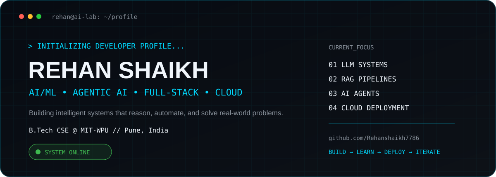
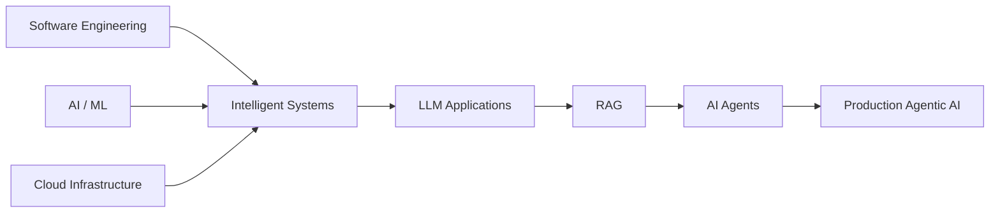

<div align="center">
<picture>
  <source media="(prefers-color-scheme: dark)" srcset="./dark.svg">
  <source media="(prefers-color-scheme: light)" srcset="./light.svg">
  
</picture>

<br>

[](https://www.linkedin.com/in/rehan-shaikh-6348a82b1)
[](https://github.com/Rehanshaikh7786)


</div>

## 👨‍💻 About Me

I'm **Rehan Shaikh**, a B.Tech Computer Science & Engineering student at **MIT-WPU** focused on building production-oriented intelligent systems.

My work sits at the intersection of **AI/ML, Generative AI, Agentic AI, full-stack engineering and cloud infrastructure**. I enjoy taking ideas from experimentation to APIs, multi-agent workflows, CI/CD pipelines and cloud deployment.

```yaml
profile:
  role: AI/ML & Agentic AI Developer
  education: B.Tech CSE @ MIT-WPU
  location: Pune, India

interests:
  - Large Language Models
  - Retrieval-Augmented Generation
  - Multi-Agent Systems
  - Computer Vision
  - Intelligent Automation
  - Cloud-Native AI
```

## 🚀 Flagship Projects

<table>
<tr>
<td width="50%" valign="top">

### ⚡ Enterprise Incident Resolution Agent

An enterprise-focused **multi-agent AI system** for accelerating incident investigation and resolution.

**Agent Pipeline**

`Triage → Log Analysis → Deployment Analysis → Infrastructure → RCA → Resolution`

**Engineering**

`Python` `LangGraph` `LangChain` `CrewAI` `FastAPI` `Docker` `AWS`

**Goal:** faster root-cause analysis and lower MTTR through intelligent orchestration.

</td>
<td width="50%" valign="top">

### 🏥 Smart Preventive Healthcare Recommendation System

AI-assisted system designed to generate **preventive healthcare recommendations** from patient health information.

Focuses on transforming health inputs into useful recommendation and decision-support workflows.

**Areas**

`AI/ML` `Recommendation Systems` `Decision Support` `Software Engineering`

</td>
</tr>
<tr>
<td width="50%" valign="top">

### 🤝 [SahaYog](https://github.com/Rehanshaikh7786/SahaYog)

Digital cooperative platform connecting households with verified gig workers.

Features service discovery, booking workflows, worker management and administrative functionality.

**Stack**

`JavaScript` `Supabase` `PostgreSQL`

</td>
<td width="50%" valign="top">

### 👁️ Real-Time Object Detection

Computer-vision work developed during my software/AI internship experience.

Explores real-time object identification and assistive vision use cases.

**Stack**

`Python` `OpenCV` `YOLO` `Computer Vision`

</td>
</tr>
</table>

## 💼 Experience

### Software / AI Engineering Intern — Mindorbit Software Solutions

Worked on **AI tools and intelligent application development**, including computer-vision experimentation and AI integration work.

- Built and experimented with real-time object detection using **Python, OpenCV and YOLO**
- Worked with AI application development and integration concepts
- Strengthened practical development workflows using Python tooling and GitHub

## 🧠 Agentic AI Journey

Completed hands-on learning across the modern AI engineering stack:

`Python` → `Machine Learning` → `Deep Learning` → `LLMs` → `RAG` → `Agentic AI` → `MCP` → `Cloud Deployment`

Current interests include **LangGraph orchestration, CrewAI, AutoGen, RAG pipelines, tool-using agents and production AI systems**.

## Tools I Work With

I prefer keeping the stack simple and choosing tools around the problem rather than forcing every project into the same framework.

<table>
<tr>
<td valign="top" width="33%">

**AI & intelligent systems**

Python<br>
LangChain / LangGraph<br>
RAG & LLM applications<br>
Hugging Face<br>
OpenCV<br>
CrewAI / AutoGen<br>
MCP

</td>
<td valign="top" width="33%">

**Application development**

FastAPI<br>
JavaScript<br>
React / Next.js<br>
C++<br>
REST APIs<br>
SQL

</td>
<td valign="top" width="33%">

**Infrastructure & data**

AWS<br>
Docker<br>
Git & GitHub Actions<br>
PostgreSQL<br>
Supabase<br>
SQLite<br>
CI/CD

</td>
</tr>
</table>

> Most of my current work is around **Python + AI agents + APIs + AWS**.

## 🔬 Research & Innovation

- **AI/ML Applications for Climate Sustainability** — research exploring machine learning, explainability, sustainability scoring, simulation and recommendation workflows.
- Exploring **Generative AI for personalized education**, including adaptive learning-path recommendation.
- Selected among the **Top 100 teams from MIT-WPU** in Smart India Hackathon participation.

## 🏆 Highlights

```text
AI / ML Engineering          ███████████████████░  Building
Agentic AI Systems           ███████████████████░  Building
Cloud & DevOps               █████████████████░░░  Growing
Full-Stack Engineering       █████████████████░░░  Growing
Research & Innovation        ████████████████░░░░  Exploring
```

## 📊 GitHub Intelligence

<div align="center">


<br><br>


</div>

## 🐍 Contribution Network

<div align="center">
<picture>
  <source media="(prefers-color-scheme: dark)" srcset="https://raw.githubusercontent.com/Rehanshaikh7786/Rehanshaikh7786/output/github-snake-dark.svg">
  <source media="(prefers-color-scheme: light)" srcset="https://raw.githubusercontent.com/Rehanshaikh7786/Rehanshaikh7786/output/github-snake.svg">
  
</picture>
</div>

## 🎯 What I'm Building Toward



<div align="center">

### `AI_SYSTEM://ONLINE`

**AI Engineering · Agentic Systems · Intelligent Automation · Cloud**

> Build systems that don't just predict — build systems that reason and act.

**Open to learning, collaboration and ambitious AI engineering opportunities.**

</div>
