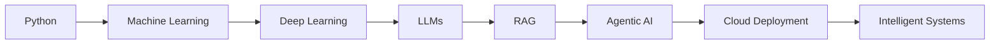

<div align="center">
<picture>
  <source media="(prefers-color-scheme: dark)" srcset="./dark.svg">
  <source media="(prefers-color-scheme: light)" srcset="./light.svg">
  
</picture>

[](https://www.linkedin.com/in/rehan-shaikh-6348a82b1)
[](https://github.com/Rehanshaikh7786)

</div>

## `> whoami`

```yaml
name: Rehan Shaikh
education: B.Tech Computer Science & Engineering @ MIT-WPU
location: Pune, India
focus: [AI/ML, Generative AI, Agentic AI, Full-Stack, Cloud]
currently_building: [AI Agents, RAG Systems, Intelligent Automation]
```

I build intelligent systems combining **AI reasoning, software engineering and cloud infrastructure** — from multi-agent workflows and RAG applications to computer vision, APIs and cloud-deployed software.

## 🧠 Featured Systems

| Project | What I'm building | Core stack |
|---|---|---|
| ⚡ **Enterprise Incident Resolution Agent** | Multi-agent workflow for triage, log/deployment analysis, infrastructure analysis, RCA and resolution | Python · LangGraph · LangChain · FastAPI · Docker · AWS |
| 🏥 **Smart Preventive Healthcare Recommendation System** | AI-assisted preventive recommendations based on patient health information | AI/ML · Recommendation Systems |
| 🤝 **[SahaYog](https://github.com/Rehanshaikh7786/SahaYog)** | Cooperative platform connecting households with verified gig workers | JavaScript · Supabase · PostgreSQL |
| 👁️ **Real-Time Object Detection** | Real-time computer vision and assistive object-detection work | Python · OpenCV · Deep Learning |

## ⚙️ Technology Arsenal

<div align="center">


</div>

## 🧬 Engineering Direction



## 📊 GitHub Intelligence

<div align="center">


<br><br>

</div>

## 🐍 Contribution Network

<div align="center">
<picture>
 <source media="(prefers-color-scheme: dark)" srcset="https://raw.githubusercontent.com/Rehanshaikh7786/Rehanshaikh7786/output/github-snake-dark.svg">
 <source media="(prefers-color-scheme: light)" srcset="https://raw.githubusercontent.com/Rehanshaikh7786/Rehanshaikh7786/output/github-snake.svg">
 
</picture>
</div>

---
<div align="center">

### `SYSTEM STATUS: BUILDING`
**AI Engineering • Agentic Systems • Intelligent Automation • Cloud**

*Build systems that don't just predict — build systems that reason and act.*
</div>
